

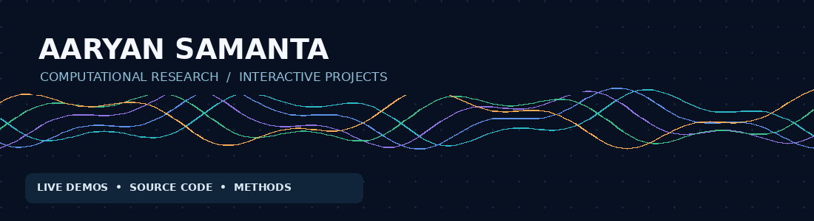

# Aaryan Samanta · Computational Research Portfolio

**Build. Test. Question. Improve.**  
*An 11th-grade student's collection of computational research, interactive scientific prototypes, and educational technology.*

   

**Research code · Working demonstrations · Project documentation**

## 🚀 Explore the projects — demo first, source code next

**14 projects · One directory · One click to a demo, one click to code.** Ordered for an admissions reviewer: compelling working demonstrations first, followed by externally evaluated research, applied platforms, and coursework. This is an editorial presentation order, not an official prestige ranking.

**▶ Live demo** opens the project site; **⌘ Source** opens code and documentation. The small animations are original decorative scientific motifs, **not** captured experiment footage or evidence of model performance. Some project sites are explainers rather than deployed inference services.

| # | Animated preview | Project & distinction | What to explore | Demo / site | Source code |
|:--:|:--:|---|---|:--:|:--:|
| 01 | 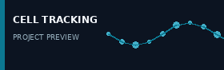 | **Biohub Cell Tracking** Kaggle Silver · #28 / 3,947 · 2026 | Geometric fusion & multi-object cell tracking | [**▶ Live demo**](https://aaryansamanta.github.io/biohub-cell-tracking/) | [**⌘ Source**](https://github.com/aaryansamanta/usaco-kaggle/tree/main/kaggle/biohub-cell-tracking) |
| 02 | 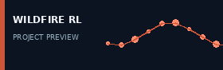 | **InfernoTactics — Wildfire RL** UCLA COSMOS · five-student team · 2026 | Geospatial simulation & actor–critic resource dispatch | [**▶ Live demo**](https://aaryansamanta.github.io/ucla-cosmos-c1) | [**⌘ Source**](https://github.com/aaryansamanta/ai-research-publications/tree/main/ucla-cosmos-2026-c1-infernotactics) |
| 03 | 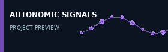 | **CogArc — Autonomic Signal Coupling** Primary prototype developer · 2026 | Interactive browser prototype; graph-attention validation planned | [**▶ Live demo**](https://cogarc.ai/) | [**⌘ Source**](https://github.com/aaryansamanta/ai-research-publications/tree/main/cogarc) |
| 04 | 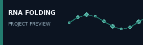 | **Stanford RNA 3D Folding Part 2** Kaggle Silver · #92 / 1,867 · 2026 | Template-based RNA modeling & Protenix pipeline | [**▶ Live demo**](https://aaryansamanta.github.io/stanford-rna-3d-folding-2) | [**⌘ Source**](https://github.com/aaryansamanta/usaco-kaggle/tree/main/kaggle/stanford-rna-3d-folding-2) |
| 05 | 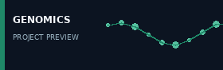 | **C. elegans Mitochondrial Resilience** UCSB SRA · IJHSR research · 2025–26 | Population genomics, RNA-seq & expression modeling | [**▶ Live demo**](https://aaryansamanta.github.io/ijhsr-uscb-sra) | [**⌘ Source**](https://github.com/aaryansamanta/ai-research-publications/tree/main/ijhsr-2026-celegans-mito-resilience) |
| 06 | 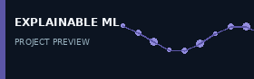 | **IEEE AIAM — Explainable ML** IEEE AIAM research · 2025 | Implemented XGBoost/SHAP analysis; GA–GNN paper methodology distinguished | [**▶ Live demo**](https://aaryansamanta.github.io/ieee-aiam) | [**⌘ Source**](https://github.com/aaryansamanta/ai-research-publications/tree/main/ieee-aiam-2025-ga-gnn) |
| 07 | 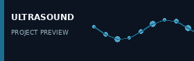 | **Pelvic-Floor Ultrasound Analysis** Stanford Urology · mentored research · 2026 | Ultrasound-derived displacement, velocity & acceleration | [**▶ Live demo**](https://aaryansamanta.github.io/stanford-urology) | [**⌘ Source**](https://github.com/aaryansamanta/ai-research-publications/tree/main/stanford-urology-2026) |
| 08 | 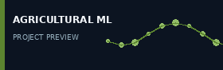 | **Kaggriculture** Kaggle Silver · #254 / 10,148 · 2026 | Agricultural ML experiments | [**▶ Live demo**](https://aaryansamanta.github.io/kaggriculture) | [**⌘ Source**](https://github.com/aaryansamanta/usaco-kaggle/tree/main/kaggle/kaggriculture) |
| 09 | 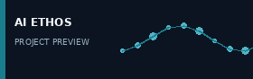 | **AI Ethos — Equitable AI Learning** Founder-led nonprofit · live platform | Multilingual AI tutoring and accessible education platform | [**▶ Live demo**](https://aiethos.org) | [**⌘ Source**](https://github.com/aaryansamanta/ai-ethos) |
| 10 | 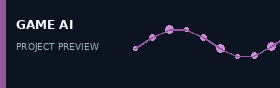 | **Pokémon TCG AI Battle** Kaggle Bronze · #466 / 6,807 · 2026 | Game simulation and algorithmic decision-making | [**▶ Live demo**](https://aaryansamanta.github.io/pokemon-tcg-ai-battle) | [**⌘ Source**](https://github.com/aaryansamanta/usaco-kaggle/tree/main/kaggle/pokemon-tcg-ai-battle) |
| 11 | 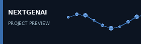 | **NextGenAI — Global AI Education** Founder-led student organization · live platform | AI education, youth leadership & international collaboration | [**▶ Live demo**](https://nextgenai.org) | [**⌘ Source**](https://github.com/aaryansamanta/nextgen-ai) |
| 12 | 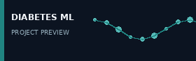 | **Diabetes Risk Prediction** Machine Learning Honors capstone · 2026 | Supervised classification & model comparison | [**▶ Live demo**](https://aaryansamanta.github.io/machine-learning-honors) | [**⌘ Source**](https://github.com/aaryansamanta/advanced-ai-curriculum/tree/main/machine_learning_honors) |
| 13 | 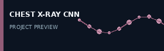 | **Pneumonia Detection with CNNs** AI Internship Honors capstone · 2025 | Chest X-ray classification with convolutional networks | [**▶ Live demo**](https://aaryansamanta.github.io/ai-internship-honors) | [**⌘ Source**](https://github.com/aaryansamanta/advanced-ai-curriculum/tree/main/ai-internship-honors/00_aii_capstone_project) |
| 14 | 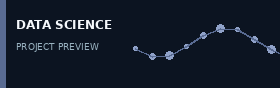 | **Healthcare Data Analysis** Data Science Honors capstone · 2025 | Exploratory analysis & scientific visualization | [**▶ Live demo**](https://aaryansamanta.github.io/data-science-honors) | [**⌘ Source**](https://github.com/aaryansamanta/advanced-ai-curriculum/tree/main/data-science-honors/00_ds_capstone_project) |

---

## 🧭 Behind the builds

| Research practice | What the portfolio shows |
|---|---|
| **Reproducibility** | Project-level source repositories, technical notes, and available notebooks |
| **Scientific care** | Distinction between implemented systems, preliminary analyses, and future experiments |
| **Collaboration** | Team and mentor contributions identified rather than presented as solo work |
| **Real-world use** | AI Ethos and NextGenAI connect software projects with education and community initiatives |

### Research notes & attribution

- **IEEE AIAM:** The accessible software demonstration features XGBoost/SHAP; the GA–GNN research-paper methodology should not be mistaken for a verified end-to-end implementation in the linked code.
- **UCLA COSMOS:** InfernoTactics was developed as part of a five-student team. **UCSB:** The *C. elegans* project involved research collaborators and mentors.
- **CogArc:** The interactive browser prototype is implemented; graph-attention validation and wearable/EEG experiments are planned, not completed.
- **Stanford Urology:** Mentored analysis uses existing clinical measurements; identifiable patient data are not included here.
- **AI Ethos / NextGenAI:** Website and repository links are provided. Specific personal coding contributions should be identified in their respective READMEs.
- **Competition placements:** Rankings are reproduced from the provided project list and should be checked against official competition records.

## 🗃️ All five code repositories

| Repository | Focus |
|---|---|
| [**AI Research & Publications**](https://github.com/aaryansamanta/ai-research-publications) | IEEE AIAM · *C. elegans* · Stanford Urology · UCLA COSMOS · CogArc |
| [**USACO & Kaggle**](https://github.com/aaryansamanta/usaco-kaggle) | Biohub · Stanford RNA · Kaggriculture · Pokémon TCG |
| [**Advanced AI Curriculum**](https://github.com/aaryansamanta/advanced-ai-curriculum) | Diabetes · Pneumonia CNN · Healthcare analytics |
| [**AI Ethos**](https://github.com/aaryansamanta/ai-ethos) | Education-platform project |
| [**NextGenAI**](https://github.com/aaryansamanta/nextgen-ai) | Student-led AI education platform |

---

**Curiosity → Build → Test → Learn**

Created for clear exploration of hands-on projects · Updated November 2026

