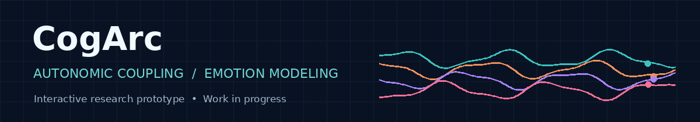

<div align="center">



# CogArc
### Exploring autonomic coupling and emotion modeling

**Interactive prototype** · **Computational neuroscience** · **Research in progress**

[**Live demo — cogarc.ai**](https://cogarc.ai/) · [**View source**](prototype/cogarc-V7.html) · [**Open locally**](index.html) · [**Research status**](#research-status)

</div>

---

## The question

Can the *relationships between physiological signals* tell us something about emotional valence that a single measurement—such as heart rate or electrodermal activity—cannot?

**CogArc** is an early-stage research effort exploring that question through autonomic physiology, biosignal representations, and graph-based modeling. This repository publishes an **interactive browser prototype** that makes the research concept approachable.

> **Important:** This is a prototype and research plan, **not** a trained or clinically validated emotion-detection system. Any simulated or illustrative outputs should not be interpreted as empirical findings.

## Explore the prototype

The existing interactive console is preserved in two locations:

- **`index.html`** — GitHub Pages entry point.
- **`prototype/cogarc-V7.html`** — original supplied V7 HTML snapshot.

**Run locally:** download the repository and open `index.html` in a modern browser. The interface is a standalone HTML/CSS/JavaScript page; Google Fonts are optional and require internet access.

**Publish on GitHub Pages:** Repository → Settings → Pages → Deploy from a branch → `main` / `(root)`. Your project URL will generally be `https://<username>.github.io/<repository>/` once Pages is enabled. The public demo is already hosted separately at **https://cogarc.ai/**; GitHub Pages hosting is optional.

## Research direction

| Area | Current direction |
|---|---|
| **Research hypothesis** | Emotional valence may be associated with patterns of *coupling* across autonomic channels |
| **Representation** | Physiological time-series features and relationships between signals |
| **Proposed model** | Graph-attention approach, compared with simpler baselines |
| **Planned public-data evaluation** | WESAD and CASE, with DEAP reserved for final held-out testing |
| **Methodological safeguards** | Baselines, ablations, and a pre-specified evaluation plan |
| **Human-participant study** | Proposed only; **no collection before required IRB approval** |

These are research intentions, **not claims that the models have been trained or experiments completed**.

## Research status

| Component | Status |
|---|---|
| Scientific question and research framework | Documented |
| Interactive browser-based V7 console | **Prototype available** |
| Graph-attention model training and validation | Planned / not evidenced in this release |
| Public-dataset benchmark results | Not reported in this release |
| Adult volunteer study | Proposed; subject to approval |

## Repository layout

```text
cogarc/
├── README.md
├── index.html                  # GitHub Pages entry point
├── prototype/
│   └── cogarc-V7.html         # Supplied prototype snapshot
├── assets/
│   └── cogarc-banner.gif      # Short animated README banner
├── docs/
│   └── RESEARCH_STATUS.md     # Scope, provenance and limitations
└── .gitignore
```

## My contribution

**Aaryan Samanta — modeling team member and primary developer of the interactive prototype.**

CogArc is a team research effort. This repository highlights the prototype implementation and the computational research direction; it does not imply that Aaryan individually authored every research document or completed every proposed experiment.

## Responsible interpretation

The interface is intended for education, exploration, and prototype demonstration. It is **not** a medical device, mental-health assessment, or diagnostic tool. Physiological signals are context-sensitive and do not uniquely determine an emotion. No volunteer data should be collected without the appropriate approvals and consent.

## Next steps

- Connect reproducible preprocessing and dataset-loading code to the research pipeline.
- Implement and compare graph-based and non-graph baselines.
- Run subject-independent evaluation and ablations.
- Document results, including negative or inconclusive findings.
- Keep any approved participant study separate from public prototype demonstrations.

---

<sub>CogArc · Early-stage research prototype · November 2026</sub>
