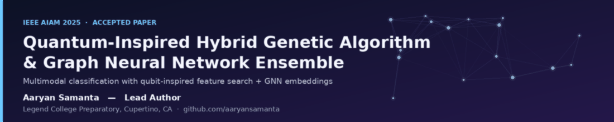
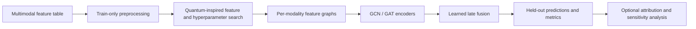

<div align="center">



# Quantum-Inspired Hybrid Genetic Algorithm & Graph Neural Network Ensemble

### Multimodal Classification · Research · Source Code · Experiments

**Aaryan Samanta** · Legend College Preparatory · Cupertino, California

[](https://doi.org/10.1109/AUTEEE67053.2025.11322272) [](code/) [](code/tests/) [](LICENSE)

**[Try the interactive research demo](docs/demo/index.html)** · **[Read the paper](paper/paper.pdf)** · **[Explore the source code](code/)** · **[View research figures](#research-figures)** · **[Run an experiment](#run-your-own-experiment)**

</div>

---

## The research question

**Can feature selection and relational learning work together to improve classification of heterogeneous, high-dimensional data?**

This project explores a hybrid approach: a **quantum-inspired genetic algorithm (QIHGA)** searches feature subsets and model settings, while **graph neural networks (GNNs)** learn relationships among selected features. A learned fusion layer combines modality-level predictions. The paper also discusses interpretability and robustness analysis.

## What I built and what I wanted to understand

I wanted to test whether selecting useful features **and** learning their relationships could work better than treating every input as an unrelated column. The project brings together probabilistic evolutionary search, feature graphs, modality-specific graph encoders and learned late fusion. The code makes these choices inspectable: search in [`qihga.py`](code/aiam_gnn/qihga.py), graph learning in [`graph_model.py`](code/aiam_gnn/graph_model.py), and evaluation in [`cli.py`](code/aiam_gnn/cli.py).

The most interesting question is not just whether a model scores higher, but **which representation decisions help, under what split, and at what computational cost**. The paper reports results on a particular split; the executable pipeline also supports new experiments and reports their metrics separately.

**[Explore the interactive explanation →](docs/demo/index.html)** — feature selection, graph propagation, fusion and paper-reported evaluation, in a static browser demo.

## At a glance

| Research component | What it does | Where to explore |
|:--|:--|:--|
| Quantum-inspired search | Encodes feature-selection choices using probabilistic amplitudes and evolutionary updates | [`code/aiam_gnn/qihga.py`](code/aiam_gnn/qihga.py) |
| Graph learning | Constructs feature graphs and trains GCN or GAT encoders | [`code/aiam_gnn/graph_model.py`](code/aiam_gnn/graph_model.py) |
| Multimodal fusion | Learns weights to combine predictions across modalities | [`code/aiam_gnn/graph_model.py`](code/aiam_gnn/graph_model.py) |
| Evaluation | Compares with random forest, SVM and logistic regression on a held-out test split | [`code/aiam_gnn/cli.py`](code/aiam_gnn/cli.py) |
| Interpretation | Optionally estimates feature attributions and noise sensitivity for a fresh run | [`code/README.md`](code/README.md) |

## How the approach fits together



The diagram summarizes the QIHGA–GNN research workflow.

## Paper-reported result and interpretation

The manuscript reports **90% accuracy, precision, recall and F1** on a **20-sample test split**, with confusion counts **TP 9 · FP 1 · TN 9 · FN 1**. Its comparison table labels two additional models **Baseline 1 (85%)** and **Baseline 2 (88%)** across the same metrics. Those labels should not be silently replaced with the names of the three baseline algorithms available in the CLI. These are manuscript-reported figures, not values automatically generated when you run the repository on a new dataset.

**Limits worth investigating:** a 20-sample test set is small; scores depend on the split, modality definitions and dataset. Additional seeds, confidence intervals, independent datasets and ablations would help establish generality.

## Research figures

<div align="center">

**Research framework**


**Performance comparison**


</div>

<details>
<summary><strong>More figures — interpretability and sensitivity</strong></summary>

| Feature attribution | Dependence | Sensitivity |
|:--:|:--:|:--:|
|  |  |  |

*Research figures accompanying the manuscript.*

</details>

## Run your own experiment

The code supports **Python 3.10+**, CSV/TSV/XLSX input, binary labels, and at least two user-defined feature modalities. It does not automatically infer modality groups from the bundled spreadsheet.

```bash
# From repository root
python -m pip install -e "./code[test]"
python -m pytest -q code/tests

# Inspect command-line arguments
python -m aiam_gnn --help
```

Create a JSON file mapping each modality to its feature columns, using [`code/configs/modalities.example.json`](code/configs/modalities.example.json) as a template. Then run, for example:

```bash
aiam-gnn \
  --input path/to/your_data.csv \
  --label target \
  --positive 1 \
  --modalities path/to/modalities.json \
  --encoder gcn \
  --seed 42 \
  --output results
```

The command creates a new results directory containing `metrics.json`, `run.json`, `test_predictions.csv`, and `weights.pt`. Add `--explain` for attribution and sensitivity CSV files. Replace the example paths and label with the appropriate columns in your dataset. See the [implementation guide](code/README.md) for assumptions, splits, and output definitions.

## Repository map

```text
ieee-aiam-2025-ga-gnn/
├── README.md                 Research story, links, quick start
├── banner.png                Original static banner
├── asset/                    Original paper figures + animated banner
├── paper/                    Manuscript, LaTeX, BibTeX, PDF, publication artifacts
├── docs/                     Non-duplicate supporting documentation
├── data/                     Bundled dataset (aiam-data.xlsx)
├── code/                     Installable Python research project
│   ├── aiam_gnn/             Graph models, search, CLI
│   ├── configs/              Example modality mapping
│   ├── tests/                Automated tests
│   ├── experiment.ipynb      Notebook entry point
│   ├── run_experiment.py     CLI launcher
│   ├── pyproject.toml        Package metadata
│   ├── requirements.txt      Dependencies
│   └── README.md             Methods and experiment guide
├── .github/workflows/        Continuous integration
└── LICENSE                   MIT license for original repository code
```

## Publication & citation

**Aaryan Samanta.** *Quantum-Inspired Hybrid Genetic Algorithm and Graph Neural Network Ensemble for Multimodal Classification.* IEEE conference paper (2025).

**DOI:** [10.1109/AUTEEE67053.2025.11322272](https://doi.org/10.1109/AUTEEE67053.2025.11322272)

For formal citations, use the bibliographic record associated with the linked DOI.

---

<div align="center"><sub>Research by Aaryan Samanta · Research repository · source code, data, experiments, and publication materials.</sub></div>
