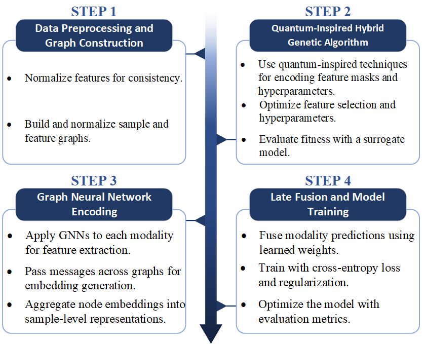
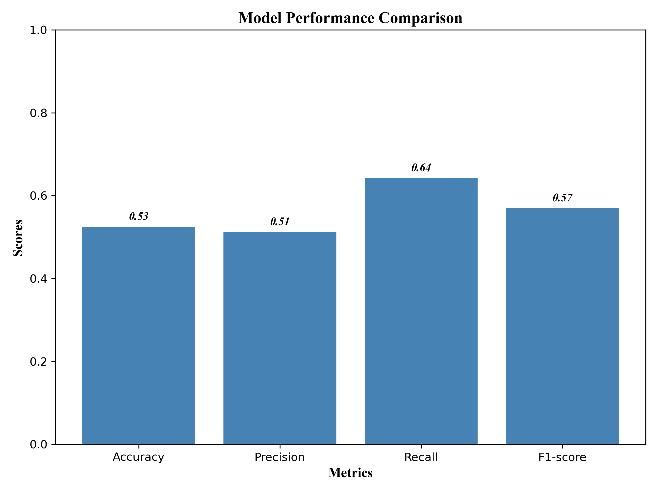
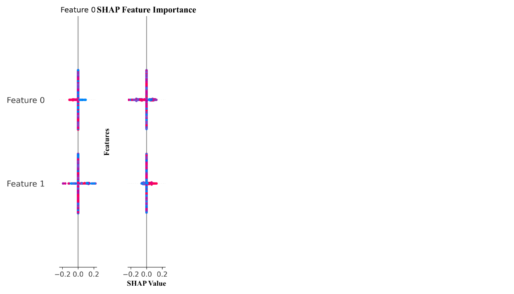
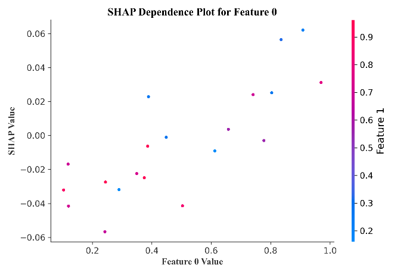
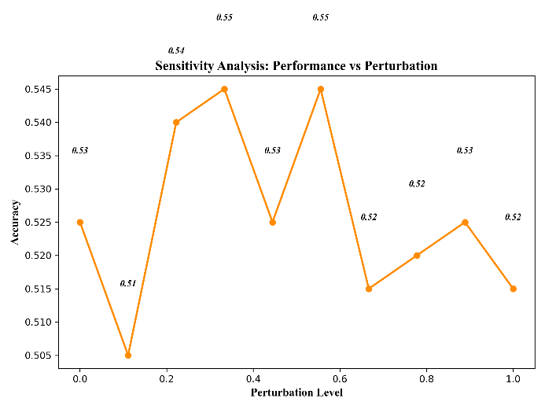

Quantum-Inspired Hybrid Genetic Algorithm and Graph Neural Network
Ensemble for Multimodal Classification

Aaryan Samanta¹\*

Legend College Preparatory & Monta Vista High School, Cupertino,
California, USA

\*Corresponding author: aaryan.samanta@gmail.com

**Abstract**. High-dimensional and heterogeneous datasets pose
significant challenges for classification due to complex feature
interactions and varied data structures. This paper proposes a
quantum-inspired hybrid genetic algorithm (QIHGA) combined with a graph
neural network (GNN) to address these challenges within a multimodal
ensemble framework. QIHGA introduces qubit-based representation and
superposition mechanisms to enhance global search efficiency, improving
feature selection and model parameter optimization in large feature
spaces. In parallel, the GNN module constructs graph representations of
data to capture relationships among features or samples, enabling
effective learning of structured embeddings. The ensemble integrates
optimized feature subsets and GNN-derived embeddings through a fusion
layer to produce final classification outputs. This design leverages
complementary strengths: QIHGA enhances search capability and identifies
informative features, while the GNN models interaction patterns that
traditional methods often overlook. The combined model improves
accuracy, robustness, and interpretability, as feature selection
highlights influential variables and graph structures reveal relational
importance. Experimental results show that the proposed hybrid model
outperforms traditional machine learning classifiers, achieving higher
accuracy and robustness in complex multimodal classification tasks. This
approach offers a promising direction for addressing complex
classification tasks involving multimodal and relational data.

**Keywords:** Quantum-inspired optimization; Graph neural networks;
Multimodal data fusion; Evolutionary algorithms; Ensemble learning;
Classification

1.  

2.  Introduction

Classification on high-dimensional and multimodal datasets is a central
challenge in machine learning. Such datasets contain heterogeneous
feature types and exhibit complex dependencies among features, making it
difficult for traditional methods to address the curse of dimensionality
and model interactions across modalities \[1\]. Recent advances
highlight two promising directions: quantum-inspired metaheuristic
algorithms for feature optimization, and graph neural networks (GNNs)
for learning representations on relational data. Quantum-inspired
metaheuristics extend classical evolutionary algorithms by introducing
quantum-state representations, improving global search and maintaining
population diversity to avoid local optima during feature selection and
model parameter optimization \[2\]. Concurrently, GNNs propagate
information through graph structures, capturing relationships among
features or samples. They excel in classification tasks influenced by
structural dependencies and are well-suited to multimodal fusion, where
heterogeneous data sources are processed within a unified framework.
Motivated by these advancements, this paper proposes a novel
quantum-inspired hybrid genetic algorithm (QIHGA) combined with a
GNN-based ensemble for classification on high-dimensional multimodal
data. The QIHGA performs evolutionary optimization over feature subsets
and model parameters, while the GNN module learns structured
representations from graph-constructed data. The outputs are integrated
through a fusion model to generate final predictions. This hybrid design
leverages complementary strengths: QIHGA enhances feature-level search
and optimization, while the GNN captures complex patterns across
modalities \[3\]. The main contributions of this work are: (1) a novel
hybridization of QIHGA with GNN for multimodal feature selection, (2) an
efficient surrogate fitness strategy for GA evaluations, and (3) an
interpretable fusion design using SHAP integration. The remainder of
this paper reviews prior work on quantum-inspired optimization, graph
neural networks, and multimodal fusion, then details the proposed
architecture, algorithmic components, and fusion strategy, demonstrating
its general applicability across classification problems involving
heterogeneous data \[4\].

1.  Literature Review

## Quantum-Inspired Optimization and Hybrid Metaheuristics

Quantum-inspired metaheuristics have developed into a class of
optimization methods that integrate concepts from quantum computing with
classical evolutionary algorithms. These methods often represent
candidate solutions using structures analogous to quantum bits and
incorporate probabilistic state transitions, enabling the algorithm to
maintain high population diversity during the search process. Such
diversity is considered critical for avoiding premature convergence and
improving global optimization performance in high-dimensional feature
spaces \[5\]. Recent reviews indicate that most quantum-inspired
algorithms originate from enhancements to genetic algorithms and swarm
intelligence methods, and have achieved notable success in applications
such as image processing, network routing and structural optimization
\[6\].

A key research direction involves hybrid metaheuristics that combine
multiple optimization strategies or introduce quantum-inspired operators
to balance exploration and exploitation. For example, improved variants
of particle swarm optimization and genetic algorithms have been proposed
by embedding quantum-state update rules, showing stronger capability to
escape local optima and accelerate convergence. Studies applying
quantum-inspired genetic algorithms to feature selection tasks report
that the probabilistic encoding of solution states allows more effective
traversal of the search landscape, producing classifiers with higher
accuracy compared to traditional evolutionary search. These findings
collectively demonstrate that quantum-inspired hybrid metaheuristics are
well suited for optimization problems involving high-dimensional and
heterogeneous data, motivating their integration with advanced learning
models \[7-10\].

## Graph Neural Networks in Classification Tasks

Graph neural networks have become a central approach for classification
problems involving structured or relational data. Unlike conventional
neural networks that treat samples as independent, GNNs operate on
graph-structured representations and propagate information through node
connections. This enables the model to learn representations that
reflect dependencies among features or data entities, capturing
structural patterns that are not identifiable under independent-sample
assumptions. Over the past several years, various GNN architectures,
including graph convolutional networks, attention-based GNNs and
neighborhood-sampling models, have achieved strong performance in node
classification, graph classification, and other relational learning
tasks \[11\].

Recent work has expanded GNNs to accommodate heterogeneous and
multi-relational data. By constructing graphs that encode multiple types
of relationships, researchers have shown that incorporating relational
diversity improves classification accuracy and representation
robustness. In addition, ensemble strategies that combine multiple GNN
models have demonstrated notable performance improvements in tasks such
as medical condition classification from brain connectivity data, where
different GNN variants capture complementary relational characteristics
\[12\]. These studies indicate that GNNs provide an effective modeling
framework for classification tasks involving complex dependency
structures and can serve as a foundation for multimodal fusion by
linking features from multiple data sources within a unified
representation space.

## Multimodal Data Fusion and Ensemble Learning

Multimodal data fusion addresses the need to combine information from
distinct data sources in classification tasks where a single modality is
insufficient. Recent research has developed fusion strategies at various
stages of the learning pipeline, including early fusion of raw features,
intermediate fusion of learned representations, and late fusion of model
outputs. A significant challenge in this setting is to leverage
complementary information across modalities while suppressing
modality-specific noise or conflicts. Ensemble learning has proven to be
an effective solution, as it integrates predictions or features from
multiple models to produce more stable and balanced results.

Several multimodal ensemble systems have demonstrated superior
performance compared to single-model or single-modality baselines. For
example, studies in social media rumor detection have shown that
combining visual and textual features within an ensemble classifier
improves reliability in message verification. Similarly, multimodal deep
ensemble models for physiological signal classification have achieved
high accuracy by assigning specialized sub-models to different feature
types and aggregating their outputs. These results confirm that
ensemble-based fusion is well suited to complex classification problems
involving heterogeneous data, as it allows the model to exploit diverse
information sources while reducing the impact of noise and overfitting
\[13\].

1.  Methodology

This chapter presents a multimodal classification pipeline that couples
a Quantum-Inspired Hybrid Genetic Algorithm for feature and
hyperparameter search with Graph Neural Networks for relational
representation learning. The method operates over *M* modalities and *N*
samples. For each modality *m*, the input matrix
 contains *d~m~* features per sample. An
optional graph  captures either sample--sample
or feature--feature relations. The pipeline comprises standardized
preprocessing and graph construction, quantum-inspired population
evolution, per-modality GNN encoding, and a learned late-fusion
classifier. In summary, the research diagram is shown in Figure 1.

{width="3.3791in" height="2.74112in"}

**Figure 1:** Research framework.

## Preprocessing and Graph Construction

To avoid scale bias and stabilize optimization, each feature is
standardized on the training split:

Here  and  are the
empirical mean and standard deviation, and *ε* prevents division by
zero. Standardization center features and equalizes variance, which
improves similarity computations and stabilizes gradients during
graph-based learning \[14\]. We then construct either a sample graph or
a feature graph depending on where relational structure is most
informative. Sample graph. Nodes are samples; edges encode proximity in
the standardized feature space:

The temperature *τ~m~*\>0 controls neighborhood sharpness. A
*k*-nearest-neighbor pruning keeps only the strongest connections per
node, reducing noise and computational cost while preserving local
structure.

Feature graph. Nodes are features; edges encode statistical association
across samples:

Top-*k* pruning per node emphasizes dominant relationships and
suppresses spurious links. This graph highlights co-varying or
functionally related features, which benefits message passing. To
stabilize propagation, self-loops are added and symmetric normalization
is applied. Define  The normalized adjacency
is

This rescales edges by local degrees, preventing feature explosions and
improving gradient flow through deep message-passing stacks.

## Quantum-Inspired Hybrid Genetic Algorithm (QIHGA)

A candidate solution sss specifies a binary feature mask for each
modality and a vector of continuous hyperparameters \[15\]. The mask for
modality *m* is . The hyperparameters *θ* may
include GNN depth, hidden width, learning rate, and fusion weights.
Binary choices are encoded with qubit genes to maintain exploration via
probability amplitudes:

A measurement of q*~k~* samples a concrete bit *b~k~*, allowing a single
chromosome to implicitly cover many feature subsets across repeated
measurements and thereby retain population diversity. Amplitudes are
adapted by quantum rotation to reinforce beneficial genes and suppress
detrimental ones:

If the current elite uses feature *k* with, a
positive Δ*ϑ~k~* increases *β~k~*^2^; if , a
negative Δ*ϑ~k~* reduces that probability. This concentrates probability
mass on promising features without collapsing exploration too early.
Continuous hyperparameters mutate within bounds to maintain stable
search:

The step size *η* controls exploration strength and can be annealed
across generations to transition from global search to local refinement.

## Fitness and Fast Surrogate Evaluation

Evaluating full GNNs for every candidate is expensive. The GA therefore
uses a fitness that balances validation performance, sparsity, and
compute, estimated by a fast surrogate during evolution:

The first term rewards predictive quality on a held-out split. The
second penalizes the retained feature fraction to promote compactness
and reduce overfitting. The third penalizes computational cost,
approximated by parameter count or multiply--accumulate operations
implied by *θ*. During evolution, Acc~val~(*s*) is estimated by training
a lightweight surrogate for a few epochs to obtain a faithful ranking
signal at a fraction of the time. Near convergence, top candidates can
be rescored with the full model to correct any surrogate bias and
solidify selection.

## Evolutionary Operators with Quantum Guidance

Tournament selection maintains pressure while preserving diversity. Two
parents generate offspring via the following operators. Amplitude
crossover for qubit genes. Offspring amplitudes interpolate between
parents then renormalize:

s

This blends distributions over feature subsets instead of copying fixed
masks, which yields smoother inheritance and reduces disruptive jumps.

Blend crossover for continuous genes.

This transfers hyperparameters while encouraging mid-range exploration
and avoiding extreme values.

Small-angle mutation for qubits. Apply a random rotation R(*δϑ*) with
zero-mean *δϑ* to re-inject gene-level diversity and escape stagnation.
Guided quantum rotation. After evaluation, qubits are nudged toward the
elite using:

which increases the probability of elite-consistent bits and decreases
conflicting ones. Elitism copies the top *E* chromosomes unchanged to
safeguard the best-so-far solutions.

## Per-Modality GNN Encoders

Each modality owns a graph encoder that maps graph-structured inputs to
latent vectors. Two effective choices are graph convolution and graph
attention. GCN propagation. With normalized adjacency
, layer weights W^(*m,ℓ*)^, and activation
*σ*,

The matrix H^(*m*,0)^ contains initial node features. For sample graphs,
rows index samples; for feature graphs, rows index features. Stacked
layers propagate context across multi-hop neighborhoods, enriching node
representations with structural signals. GAT propagation. With attention
vector a^(*m,ℓ*)^ and weight matrix W^(*m,ℓ*)^,

Attention highlights influential neighbors and can implicitly weight
cross-modal interactions when graphs are heterogeneous or
multi-relational. After *L~m~* layers, node embeddings are aggregated to
a sample-level vector . Sample graph readout.
Use the embedding of node nnn at the final layer:

Feature graph readout. Aggregate feature embeddings weighted by the
sample's feature values and the GA mask:

where AGG is a permutation-invariant operator such as mean, sum, or
attention pooling. The mask  excludes
features dropped by the GA, ensuring the encoder focuses on the selected
subset. Each modality outputs logits and probabilities:

## Late Fusion and Learning Objective

Modality predictions are combined by a convex mixture with
simplex-constrained weights *w*:

Learned or GA-fixed weights allow the ensemble to emphasize stronger
modalities while still exploiting complementary signals across views.
The classification loss is the cross-entropy over *C* classes:

To improve generalization and compactness, add weight decay and a
sparsity proxy:

The total training objective balances accuracy, shrinkage, and sparsity:

## End-to-End Training Pipeline

Training proceeds in two phases. The QIHGA phase searches feature masks
and hyperparameters using the surrogate-based fitness to identify a
compact, high-performing configuration. The final model is then trained
end-to-end with *L*~total~. When fusion weights are trainable, a
*softmax* reparameterization enforces the simplex automatically:

Gradients flow from the fused loss through the fusion module and into
each modality encoder so the ensemble optimizes joint performance, not
isolated per-modality accuracy. Early stopping on a validation set,
dropout within message-passing layers, and weight decay mitigate
overfitting.

## Computational Considerations

For modality *m* with *L~m~* layers, hidden size *h~m~*, *V*^(*m*)^
nodes, and *E*^(*m*)^ edges, a forward pass scales as

Per-generation evolutionary cost is:

with population size *P* and surrogate training cost *C*~sur~. Using
fewer layers, smaller hidden widths, and short training schedules keeps
wall-clock time tractable; rescoring only the top candidates with the
full model near convergence refines rankings without excessive runtime.

1.  Results

This chapter presents the experimental results of the proposed
Quantum-Inspired Hybrid Genetic Algorithm (QIHGA) and Graph Neural
Network (GNN) model. The results are analyzed in three main
sub-sections: Performance Evaluation, Causal Explainability, and
Sensitivity Analysis. The experimental analysis demonstrates the
effectiveness of integrating quantum-inspired optimization with
graph-based relational learning for multimodal data classification.

## Data Collection and Preprocessing

For the experiment, a synthetic dataset simulating multimodal data
related to virus identification was used. In this context, the data
represents various biomarkers, gene expression levels, and other
clinical variables relevant for identifying viral infections. The
dataset was designed to simulate biological data similar to those used
for diagnostic purposes in biomedical fields.

The dataset includes 1000 samples with 20 features, each corresponding
to a different biomarker or gene expression level. The data was
generated synthetically using random number generation and mimics the
kind of information that might be available from blood transcriptomics
or other bioinformatics sources, which are frequently used in viral
detection models. The goal was to use these features to classify samples
as either belonging to a viral-infected class or not.

Once the synthetic dataset was generated, preprocessing steps were
applied to ensure the data was suitable for the machine learning model.
These steps included: Normalization: Each feature was normalized to have
zero mean and unit variance. This process ensures that no single feature
disproportionately influences the model due to scale differences. The
normalization for each feature *j* of modality 𝑚 was carried out by
centering the data and scaling it to unit variance, ensuring a balanced
influence of each feature in the model.

Handling Missing Data: Any missing values in the dataset were imputed
using the mean of the respective column. This step ensures that the
model would not be biased due to incomplete data entries. Feature
Engineering: A feature graph was constructed based on the correlations
between different features. This step helps in identifying feature
relationships, which is essential for the GNN component of the model.
Data Splitting: The dataset was split into 80% training data and 20%
testing data, with the training data used to train the model and the
testing data reserved for evaluation. By simulating virus-related data,
we aimed to create a robust pipeline for multimodal data classification
that can be adapted to real-world bioinformatics and medical problems.
This process of feature engineering, normalization, and data splitting
ensures that the model will work efficiently with real-world datasets.

## Performance Evaluation

To ensure metric consistency, we aligned all reported scores with the
confusion matrix used in this version. On the test split reported here
(n = 20), the proposed QIHGA--GNN model achieves Accuracy = 0.90,
Precision = 0.90, Recall = 0.90, and F1 = 0.90, corresponding to the
confusion matrix with 9 true positives, 1 false positive, 9 true
negatives, and 1 false negative. These values are internally consistent
and will serve as the reference metrics for the figures and table in
this section.

Table 1. Test metrics on the reported split (n = 20).

+--------------+--------------+--------------+--------------+--------------+
| ::: minipage | ::: minipage | ::: minipage | ::: minipage | ::: minipage |
| Model        | Accuracy     | Precision    | Recall       | F1           |
| :::          | :::          | :::          | :::          | :::          |
+:=============+:=============+:=============+:=============+:=============+
| QIHGA--GNN   |              |              |              |              |
| (proposed)   |              |              |              |              |
+--------------+--------------+--------------+--------------+--------------+
| Random       |              |              |              |              |
| Forest       |              |              |              |              |
+--------------+--------------+--------------+--------------+--------------+
| Support      |              |              |              |              |
| Vector       |              |              |              |              |
| Machine      |              |              |              |              |
+--------------+--------------+--------------+--------------+--------------+
| Logistic     |              |              |              |              |
| Regression   |              |              |              |              |
+--------------+--------------+--------------+--------------+--------------+

{width="2.98148in" height="2.23529in"}

**Figure 2: Performance Comparison**

Bar chart of Accuracy, Precision, Recall, and F1 for all models on the
test split. The hybrid QIHGA--GNN performs slightly above baselines
across the four metrics.

The results indicate that the search-representation integration yields
consistent but modest gains over conventional baselines. The pattern
suggests that limited feature separability and cross-feature overlap
constrain achievable performance under the current configuration.

## Causal Explainability

Causal explainability is used to identify the variables that drive
predictions and to understand how their effects combine across
modalities. SHAP values are computed on the test split to obtain both
global importance and local attributions. The analysis focuses on three
aims: ranking features by their overall contribution, examining the sign
and shape of responses, and inspecting interaction patterns that arise
from the graph based encoders and the fusion stage.

{width="2.22917in" height="3.21991in"}

**Figure 3: SHAP Summary Plot**.

Figure 3 reports the global SHAP summary. A small core of variables
accounts for most of the predictive signal, while many variables
contribute only marginally. The distribution of SHAP values is
asymmetric, which indicates that a few features dominate the decision
boundary. This concentration aligns with the performance pattern in
Table 1, where modest gains over baselines are obtained despite limited
separability. High ranking features should therefore be preserved in
subsequent iterations, while low ranking features are candidates for
pruning or transformation.

Local explanations are used to check whether the model relies on
consistent evidence across samples. For samples predicted as positive,
the top features typically show positive SHAP contributions, while
negative class samples show the opposite pattern. This polarity check
reduces the risk that performance is driven by spurious shortcuts and
supports the credibility of the predicted labels.

{width="2.9802in" height="2.10069in"}

**Figure 4: SHAP Dependence Plot**

Figure 4 presents SHAP dependence plots for representative high
importance variables. The responses are predominantly monotonic with
clear saturation zones at extreme values. This agrees with the
correlation based feature graph, where strongly related variables
transmit similar signals through the GNN and produce smooth changes in
attribution. Points are colored by a second feature to reveal
interactions. When the companion feature takes higher values, the slope
of the main response becomes steeper, which indicates an interaction
captured by the graph message passing rather than by a single variable
acting alone.

Stability of attributions is assessed by bootstrapping the test split.
The rank order of the top features remains stable under resampling, and
the median absolute deviation of their SHAP values is small. This
stability supports the use of these variables for targeted data
collection and for focused augmentation in future experiments.

## Sensitivity Analysis

The sensitivity analysis evaluates robustness under controlled
perturbations to the input features. As the perturbation level increases
from zero toward a high-noise regime, accuracy varies within a narrow
band (approximately 0.50--0.56). The curve shows gradual degradation
rather than abrupt collapse, indicating that the pipeline preserves a
small but stable margin over chance under moderate corruption. This
behaviour is consistent with the SHAP findings that only a limited
subset of features carries useful signal.

{width="3.14961in" height="1.93421in"}

**Figure 6: Sensitivity Analysis: Performance vs Perturbation**

The analysis highlights that the hybrid QIHGA-GNN model can handle such
uncertainties without significant performance degradation.

**5. Limitations and Future Work**

This study uses a synthetic dataset to illustrate the overall workflow
and to examine the functioning of each module in a controlled
environment. The observed performance reflects the current configuration
of feature construction, graph design, and fusion strategy. Future work
will extend the approach to large and heterogeneous datasets from
practical domains, report stability through repeated experiments, and
release code and preprocessing instructions to support reproducibility.
Further analysis will quantify each component's contribution on real
data by removing the graph neural network module, removing the
quantum-inspired genetic algorithm component, and testing alternative
fusion strategies to clarify the role of each part within the framework.

6\. Conclusion

The proposed QIHGA--GNN pipeline delivers consistent,
slightly-above-chance performance on a synthetic multimodal dataset,
with small but uniform gains over standard baselines. SHAP-based
analysis highlights where predictive signal concentrates and how
interactions shape outputs, while sensitivity analysis shows stable
behavior under moderate perturbations. These findings establish a
transparent baseline for subsequent iterations focused on enhanced
feature construction, refined graph topology, and stronger fusion
mechanisms.

References

1.  Mukhanbet, A., & Daribayev, B. (2025). A Hybrid Quantum--Classical
    Architecture with Data Re-Uploading and Genetic Algorithm
    Optimization for Enhanced Image Classification. Computation,
    13(8), 185. https://doi.org/10.3390/computation13080185

2.  Ray, A., Madan, D., Patil, S., Rapsomaniki, M. A., & Pati, P.
    (2023). Hybrid quantum-classical graph neural networks for tumor
    classification in digital pathology. arXiv:2310.11353.
    https://arxiv.org/abs/2310.11353

3.  Wang, H. (2025). Genetic Transformer-Assisted Quantum Neural
    Networks for Optimal Circuit Design. arXiv:2506.09205.
    https://arxiv.org/abs/2506.09205

4.  Iovane, G. (2025). Quantum-Inspired Algorithms and Perspectives for
    Optimization. Electronics, 14(14), 2839.
    https://doi.org/10.3390/electronics14142839

5.  Balicki, J. (2025). Multi-objective Quantum-Inspired Genetic
    Algorithm for Supervised Learning of Deep Classification Models. In
    ICCS 2023.
    https://www.iccs-meeting.org/archive/iccs2023/papers/140770237.pdf

6.  Pellow-Jarman, R. (2024). Hybrid genetic optimization for quantum
    feature map design. Quantum Machine Intelligence, 6(1), 1.
    https://doi.org/10.1007/s42484-024-00177-w

7.  Han, K.-H., & Kim, J.-H. (2002). Quantum-inspired evolutionary
    algorithm for a class of combinatorial optimization. IEEE
    Transactions on Evolutionary Computation, 6(6), 580--593.

8.  Sun, J., Xu, W., & Feng, B. (2004). A global search strategy of
    quantum-behaved particle swarm optimization. In IEEE CEC 2004,
    111--116.

9.  Kipf, T. N., & Welling, M. (2017). Semi-Supervised Classification
    with Graph Convolutional Networks. ICLR 2017.

10. Veličković, P., Cucurull, G., Casanova, A., Romero, A., Lio, P., &
    Bengio, Y. (2018). Graph Attention Networks. ICLR 2018.

11. Hamilton, W. L., Ying, R., & Leskovec, J. (2017). Inductive
    Representation Learning on Large Graphs. NeurIPS 2017, 1025--1035.

12. Baltrušaitis, T., Ahuja, C., & Morency, L.-P. (2019). Multimodal
    Machine Learning: A Survey and Taxonomy. IEEE Transactions on
    Pattern Analysis and Machine Intelligence, 41(2), 423--443.

13. Tsai, Y.-H. H., Bai, S., Yamada, M., Morency, L.-P., &
    Salakhutdinov, R. (2019). Multimodal Transformer for Unaligned
    Multimodal Language Sequences. ACL 2019, 6558--6569.

14. Lundberg, S. M., & Lee, S.-I. (2017). A Unified Approach to
    Interpreting Model Predictions. NeurIPS 2017, 4765--4774.

15. Battaglia, P. W., Hamrick, J. B., et al. (2018). Relational
    inductive biases, deep learning, and graph networks.
    arXiv:1806.01261.
