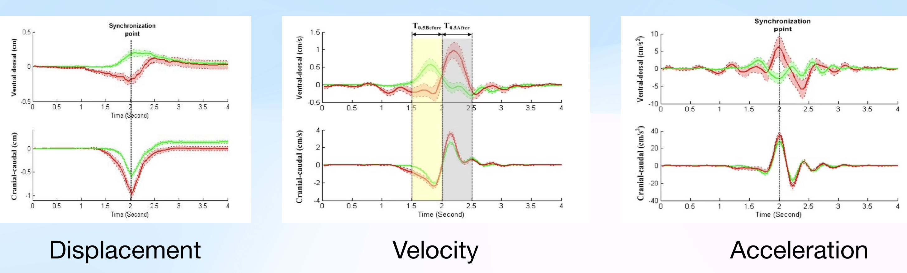

<div align="center">



# Functional Imaging of Pelvic Floor Muscles
### Ultrasound biomechanics · anatomical landmarks · quantitative motion · clinical interpretation

**Aaryan Samanta** · Research mentorship: **[Christos E. Constantinou, Ph.D.](https://profiles.stanford.edu/christos-constantinou)**, Professor Emeritus, Stanford University

[**Explore interactive Motion Lab**](https://aaryansamanta.github.io/stanford-urology/) · [**Research presentation**](02-phase-2-imaging-analysis/presentation/Functional-Imaging-of-Pelvic-Floor-Muscles_slides_2026-06-22.pdf) · [**Methods & code**](code/) · [**Clinical considerations**](research/clinical-considerations.md) · [**Video library**](media-guide/)

</div>

---

## The research question

**How do pelvic-floor structures move during voluntary contraction, sustained Valsalva and transient cough—and what can the resulting displacement, velocity and acceleration reveal about dynamic support?**

This repository documents a two-phase, Stanford-professor-mentored learning and research experience: topic and dataset exploration (December 2025–March 2026), followed by functional imaging analysis and presentation development (June 2026). The supplied presentation describes **23 asymptomatic participants**, **perineal ultrasound using a 5.5 MHz probe**, and physician-led offline analysis of motion. These are **preliminary research materials**, not an independently validated clinical study or peer-reviewed publication.

## Explore the research visually

| Voluntary contraction / The Knack | Valsalva | Cough |
|---|---|---|
|  |  |  |
| Anticipatory support | Sustained loading | Transient pressure challenge |

> **Media rights:** The clinical imaging and animations originated in the supplied research materials; confirm redistribution permission with the mentor before public GitHub hosting. These GIFs are qualitative visualizations, not calibrated patient trajectories.

### From images to equations

For a tracked anatomical landmark **r(t) = [x(t), y(t)]**:

- **Displacement:** Δr(t) = r(t) − r(0)
- **Velocity:** v(t) = dr(t)/dt
- **Acceleration:** a(t) = d²r(t)/dt²
- **Calibration:** coordinates remain in pixels until an independently verified mm/pixel scale is supplied.



*Figure supplied with the website archive and attributed to the project presentation. Verify legend, axes, measurement provenance and permissions before quantitative reuse.*

## Research structure and evidence

| Research component | Explore |
|---|---|
| Phase 1: problem framing, imaging context and foundational literature | [Topic and data](01-phase-1-topic-and-data/) |
| Phase 2: ultrasound analysis, research presentation and annotated media | [Imaging analysis](02-phase-2-imaging-analysis/) |
| Interactive anatomical model and educational motion lab | [Website source](website/) |
| Executable, tested mathematical reference implementation | [Python code](code/) |
| Measurement protocol and scientific limitations | [Methods](research/measurement-protocol.md) |
| Clinical relevance: SUI, The Knack, Valsalva, validation | [Clinical considerations](research/clinical-considerations.md) |
| Original video/animation inventory | [Video index](media-guide/) |
| Research presentation vs. peer-reviewed publications | [Research outputs](publications/) |
| What is measured, illustrative or proposed | [Evidence map](research/evidence-map.md) |
| Literature and privacy | [References](docs/references.md) · [Data & privacy](docs/data-and-privacy.md) |

## Reproducible mathematical demonstration

The `code/` directory includes a small **new educational reference implementation** of baseline-relative displacement and finite-difference derivatives, plus unit tests and an explicitly **synthetic** example CSV. It is not represented as the original physician's analysis code.

```bash
cd code
python -m unittest discover -s tests -v
python -m pelvic_motion.cli examples/synthetic_landmark_track.csv examples/synthetic_output.csv
```

## Scientific interpretation

The study of pelvic-floor kinematics may illuminate how anatomical support responds to different loads. **A displacement vector alone does not diagnose stress urinary incontinence**: physiological timing, pressure, tissue mechanics, measurement uncertainty and independent clinical outcomes matter. Read the [clinical interpretation chapter](research/clinical-considerations.md) for a structured translation from mechanism to possible future validation.

## What the source material supports—and what it does not

**Documented:** Research mentorship, source readings, two research phases, a June 22, 2026 presentation, annotated videos, and preliminary kinematic interpretation.

**Educational additions:** Interactive schematic, browser simulations, mathematical reference code, and proposed reproducibility protocol. These should not be mistaken for recovered original analysis or patient measurements.

**Not established by these files:** Original subject-level trajectories, calibration values, a validated patient-specific 3D model, a diagnostic classifier, or an Aaryan-authored peer-reviewed urology publication.

## Repository navigation

```text
stanford-urology-2026/
├── README.md                      Research overview and navigation
├── 01-phase-1-topic-and-data/     Topic, readings, introductory media
├── 02-phase-2-imaging-analysis/   Analysis log, research deck, original MP4s
├── website/                       Full interactive HTML/CSS/JS site
├── code/                          Python kinematics, CLI, tests, synthetic example
├── research/                      Measurement protocol, clinical analysis, evidence map
├── publications/                  Verified research outputs and status
├── media-guide/                   Indexed video and animation library
├── figures/                       Presentation-derived motion figure
├── docs/                          References, project summary, privacy and crosswalk
└── assets/                        Banner and GIF previews
```

---

**Research integrity:** This portfolio represents the supplied research work faithfully, while labeling newly added educational tools and unverified claims. It is not an official Stanford University website and does not provide clinical advice.
